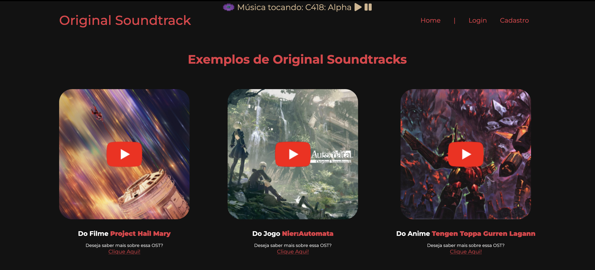
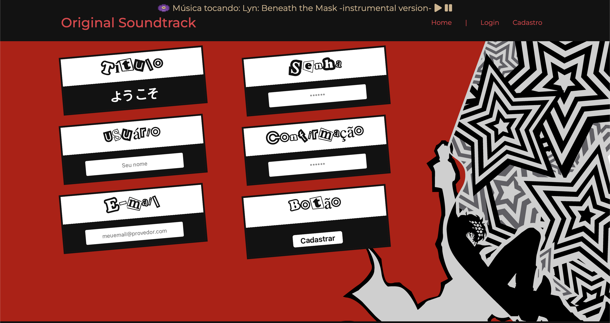
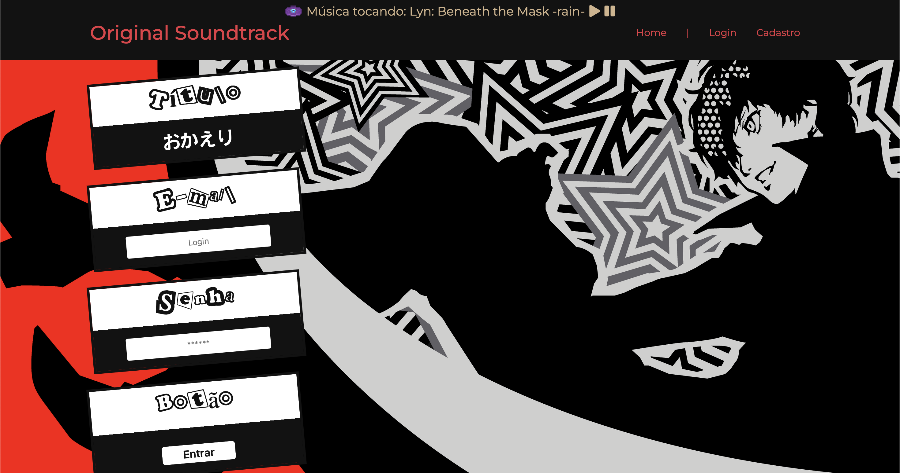
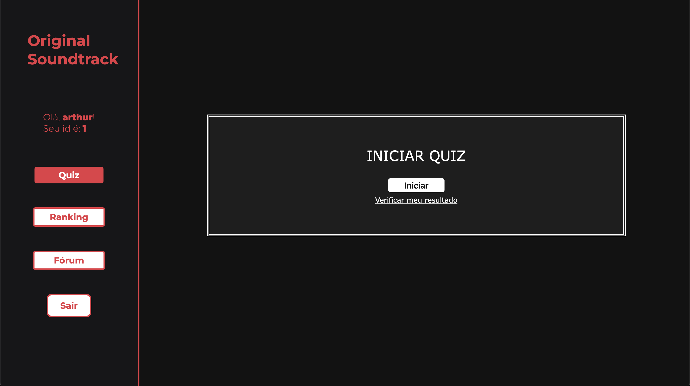
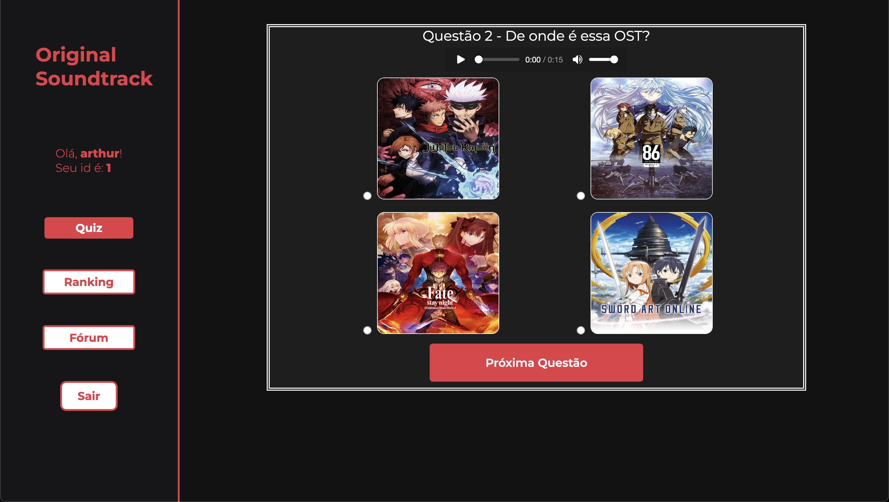
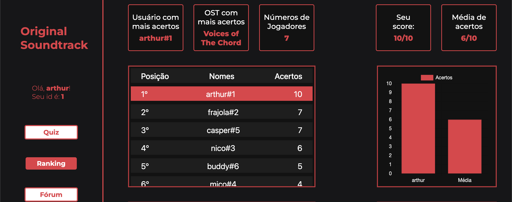
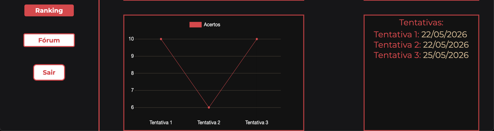
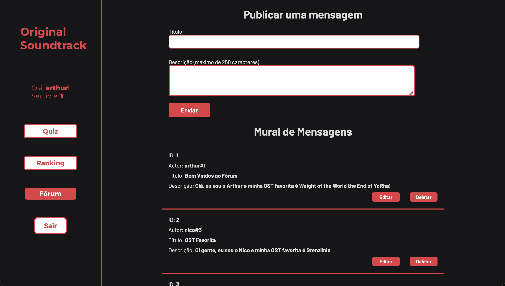

# Original Soundtrack - Projeto Individual

Música sempre esteve presente na minha vida e desde sempre a amei. O tema deste projeto é um dos diversos formatos de música existentes e também um dos meus favoritos. Poder desenvolver um site sobre Original Soundtrack e poder explicar o quão importante ela é para a indústria e para mim é extremamente gratificante.

## Tecnologias Utilizadas

### Front-end


### Back-end


# Instalação do Projeto

## 1. Clone o repositório
```bash
git clone https://github.com/arthursptech/Projeto-Individual.git
```

## 2. Instalação de dependências
```bash
npm install
```

## 3. Configure o Banco de Dados
- Crie o banco de dados usando o <a href="./src/database/script-tabelas.sql">script</a>.

## 4. Configure as variáveis de ambiente
Crie um arquivo .env e .env.dev:

```bash
DB_HOST= "localhost"
DB_DATABASE= "ost"
DB_USER= "seu_usuario"
DB_PASSWORD= "sua_senha"
PORT=3306

APP_PORT=3333
APP_HOST=localhost

LASTFM_API_KEY="sua_api_key"
LASTFM_USER=MsAqua
LASTFM_LIMITE_MUSICAS=200

SPOTIFY_PLAYLIST_ID=6VQOZVwVhlgpR00UKZXRrl
SPOTIFY_CLIENT_ID=
SPOTIFY_CLIENT_SECRET=
SPOTIFY_REDIRECT_URI=http://127.0.0.1:8080/spotify/callback
```
#### A chave do Last.fm é gratuita e pode ser criada em https://www.last.fm/api/account/create
#### As credenciais do Spotify são opcionais: sem elas só as 100 primeiras músicas da playlist são lidas. Crie um app gratuito em https://developer.spotify.com/dashboard para obter o Client ID e o Client Secret. Cadastre no app o mesmo `SPOTIFY_REDIRECT_URI` e, com o servidor rodando, acesse http://127.0.0.1:8080/spotify/login uma vez com a conta dona da playlist
#### Importante: caso sua senha contenha caracteres especiais, insira-a entre 'aspas'

## 5. Configure o ambiente

No arquivo `app.js`:

### Produção

```js
var ambiente_processo = 'producao';
```
No `.env`

### Desenvolvimento 

```js
var ambiente_processo = 'desenvolvimento';
```
No `.env.dev`

## 6. Rodando o projeto:

```bash
npm start ou node app.js
```

### Acesse http://localhost:3333

## Páginas e Funcionalidades

### <a href="./public/index.html">Homepage</a>


Na homepage é possível pausar e despausar a trilha sonora de fundo.

Na seção de Exemplos, é possível acessar uma página dedicada àquela OST clicando no "Clique Aqui!"

### <a href="./public/cadastro.html">Cadastro</a>


### <a href="./public/login.html">Login</a>


### <a href="./public/dashboard/cards.html">Quiz</a>


As músicas do quiz são sorteadas a partir de duas fontes:

- A playlist de OSTs do Spotify configurada em `SPOTIFY_PLAYLIST_ID` (todas as músicas entram)
- As músicas mais ouvidas do usuário do Last.fm configurado em `LASTFM_USER`, filtrando apenas as que têm a tag (gênero) de Original Soundtrack Cada questão toca automaticamente um trecho de 10 segundos da música correta e mostra 4 alternativas com a imagem da mídia ou, se não encontrada, a capa do álbum:

- Aberturas e encerramentos de anime: áudio oficial e identificação do anime pelo [AnimeThemes](https://animethemes.moe)
- Músicas da playlist: trecho de 30 segundos do próprio Spotify
- Demais músicas: preview da versão oficial no iTunes (com o Deezer como alternativa)
- Imagens: [AniList](https://anilist.co) para animes e Wikipedia para filmes, jogos e séries

As APIs têm limite de requisições por minuto (o iTunes aceita cerca de 20), então na primeira vez que o servidor sobe a lista de músicas leva alguns minutos para carregar. Os resultados ficam salvos na pasta `cache/` e as próximas inicializações são rápidas.

### Modelo do Quiz - Adivinhe de onde é a OST


### Dashboard - Ranking dos jogadores e gráfico do score do usuário e a média dos jogadores


### Dashboard - Gráfico mostrando a variação dos scores a cada tentativa e a data de cada tentativa


### Fórum


